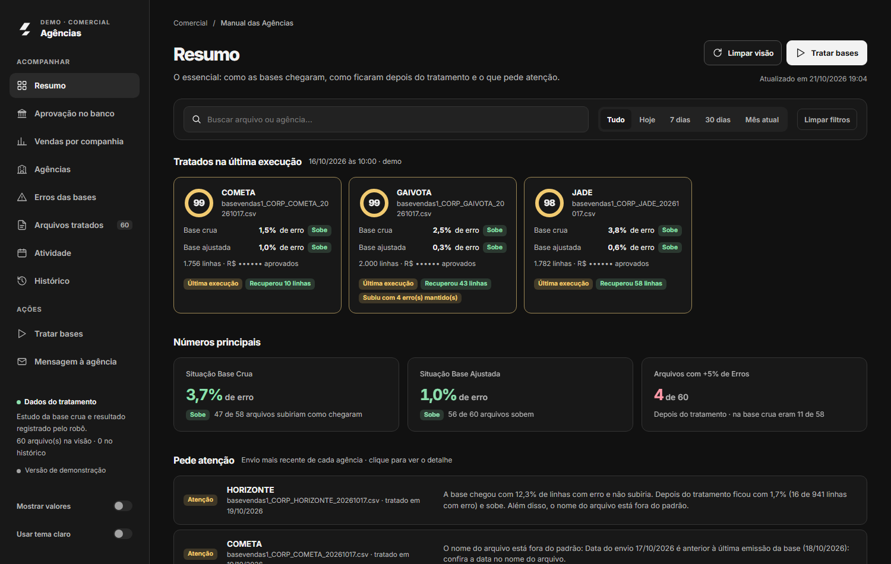

<div align="center">

# Manual das Agências

**Painel de acompanhamento das bases de vendas enviadas semanalmente por agências de viagem.**

[](https://sena295.github.io/manual-das-agencias/)
[](LICENSE)
[](https://github.com/Sena295/manual-das-agencias/releases)


[**Abrir a demonstração**](https://sena295.github.io/manual-das-agencias/) · [Releases](https://github.com/Sena295/manual-das-agencias/releases) · [Reportar problema](https://github.com/Sena295/manual-das-agencias/issues)



</div>

---

## Sobre o projeto

Toda semana as agências de viagem enviam bases de vendas. Cada base passa por um **robô de validação e tratamento**, e este painel acumula os envios para responder, em um só lugar:

- o que foi **recebido** e quando;
- o que foi **corrigido** pelo tratamento;
- o que **ficou de fora** e por quê;
- **quanto foi vendido** (aprovado) por companhia, cupom e código.

> **Todos os dados desta demonstração são fictícios.** Agências, companhias aéreas, arquivos, empresas, bilhetes e valores foram gerados aleatoriamente apenas para mostrar o funcionamento da plataforma.

## Funcionalidades

| Seção | O que mostra |
|---|---|
| **Resumo** | Situação das bases como chegaram e depois do tratamento, com o limite de 5% de erro e alertas de atenção por agência. |
| **Aprovação no banco** | Resultado de cada arquivo, antes e depois, e para onde foram as linhas. |
| **Vendas por companhia** | Vendas aprovadas por companhia, cupom e código. |
| **Agências** | Ranking pela situação do envio mais recente. |
| **Erros das bases** | Erros mais frequentes, antes e depois do tratamento. |
| **Arquivos tratados** | Lista dos arquivos processados. |
| **Atividade** e **Histórico** | Calendário de envios e histórico das execuções. |
| **Mensagem à agência** | Retorno pronto, com os ajustes necessários. |

Também inclui busca por arquivo/agência, filtros de período (hoje, 7 dias, 30 dias, mês atual), modo para ocultar valores e **tema claro/escuro**.

## Como usar

**Online:** acesse a [demonstração](https://sena295.github.io/manual-das-agencias/).

**Localmente** (não precisa instalar nada):

```bash
git clone https://github.com/Sena295/manual-das-agencias.git
cd manual-das-agencias
```

Abra o arquivo `index.html` no navegador (duplo clique ou arraste para a janela).

Dicas de navegação:

1. Use o menu lateral para alternar entre as seções.
2. Filtre por período ou busque uma agência/arquivo na barra superior.
3. Clique em **Tratar bases** para simular um novo tratamento.
4. Ative **Mostrar valores** para exibir os montantes em R$ e **Usar tema claro** para trocar o tema.

## Tecnologias

- **HTML5**, **CSS3** e **JavaScript** puros, sem frameworks e sem etapa de build.
- Página única e autocontida (`index.html`).
- Fontes [Inter](https://fonts.google.com/specimen/Inter) e [IBM Plex Mono](https://fonts.google.com/specimen/IBM+Plex+Mono) via Google Fonts.

## Estrutura

```
manual-das-agencias/
├── index.html        # aplicação completa
├── docs/
│   └── screenshot.png
├── LICENSE
└── README.md
```

## Pacotes

Este projeto não depende de pacotes (npm, pip etc.) e não publica pacotes.

## Licença

Distribuído sob a licença **MIT**. Veja [LICENSE](LICENSE).

## Autor

Desenvolvido por **Carlos Sena**, [@Sena295](https://github.com/Sena295).
